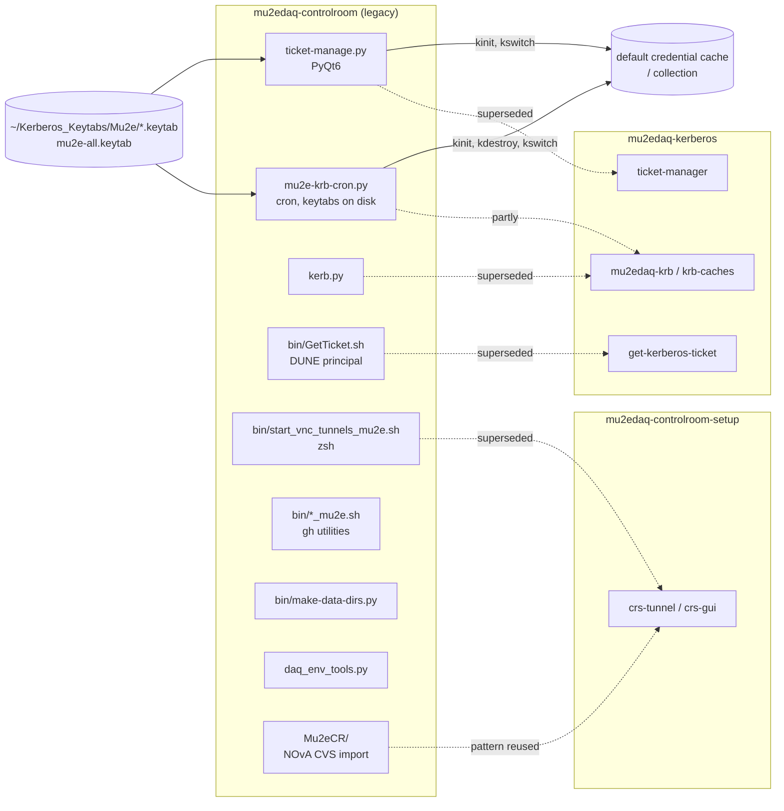

# mu2edaq-controlroom

> Legacy control-room script collection - keytab Kerberos ticket cron and GUI, a gateway VNC tunnel script, GitHub-organisation utilities and DAQ environment helpers - superseded by mu2edaq-kerberos and mu2edaq-controlroom-setup and recommended for retirement.

| | |
|---|---|
| Repository | `Mu2e/mu2edaq-controlroom` (public; formerly `Mu2e/DAQ-ControlRoom`) |
| Language | Python 3.9+ (PyYAML, python-krb5, PyQt6), bash, zsh |
| Version | none of its own; superproject tag `t01.00.00` at `076de7a` |
| Ports | none (outbound ssh and HTTPS to GitHub only) |
| Depends on | nothing in the suite; MIT/Heimdal Kerberos tools, `ssh`, `gh`, `jq` |
| Status | **superseded** — see [Deprecation](#deprecation) |

## Purpose

The first Mu2e control-room toolbox, assembled from March 2024 (first
commit `30cf717`) to April 2026 from three
sources: the Mu2e DAQ group's own Kerberos and GitHub scripts, a copy of
the DUNE control room's `GetTicket.sh`, and a CVS checkout of NOvA's
remote-control-room scripts (`Mu2eCR/`, from
`novacvs@cdcvs.fnal.gov:/cvs/nova`, `Online/pkgs/NovaRemoteControlRooms`).
Nothing in it is a service; every piece is a script a person or `cron`
runs.

## Deprecation

Both of its control-room jobs now belong to dedicated packages:
Kerberos identities to **`mu2edaq-kerberos`** (Vault-held keytabs, a C++/Python
cache library, a ticket-manager GUI) and VNC access to
**`mu2edaq-controlroom-setup`** (`crs-tunnel`, `crs-remote`, `crs-gui`).
The package is still a submodule (`.gitmodules:13-15`), listed in the
superproject `README.md:51`, tested by `testing/common.sh:31,120`, and
tagged in every suite release.

### Capability by capability

| Capability | Here | Superseded by | Evidence | What has no replacement |
|---|---|---|---|---|
| Interactive ticket switch / renew / renew-all / hourly auto-renew | `ticket-manage.py` | `ticket-manager` (mu2edaq-kerberos) | `../mu2edaq-kerberos/README.md:300-322` (Make Default, Renew Selected/All on a timer, Get New Ticket from Vault) | nothing |
| Mint a ticket for a service identity | `bin/GetTicket.sh` (configured for **DUNE**), `ticket-manage.py` "Get New Ticket" (keytab on disk) | `get-kerberos-ticket <identity>` / `--all` | `../mu2edaq-kerberos/README.md:149-170`; Vault path `td/scd/experiments/mu2e/kerberos/<identity>` | nothing; the seven Vault identities are a superset of the six here (adds `mu2edqm`) |
| List caches | `kerb.py` | `krb-caches [--json]`, `mu2edaq-krb list` | `../mu2edaq-kerberos/doc/INTERFACES.md` §1.4–1.5 | nothing |
| **Unattended ticket keeping from cron** | `mu2e-krb-cron.py` | **partial**: `mu2edaq-krb renew --all` renews every cache in the collection (Linux; `NotSupportedError` on Apple); `get-kerberos-ticket … --no-auto-login` re-mints from Vault if a Vault token is already cached | `../mu2edaq-kerberos/doc/INTERFACES.md:110-117`, `:142-145` | No shipped cron/systemd recipe (`../mu2edaq-kerberos/doc/OPERATIONS.md` has none). Re-acquisition after renew-until needs a Vault token, which an unattended host does not hold. This is the one real gap. |
| VNC ssh tunnels | `bin/start_vnc_tunnels_mu2e.sh` | `crs-tunnel`, `crs-gui` | `../mu2edaq-controlroom-setup/src/mu2edaq_controlroom_setup/tunnels.py:5` ("Generalizes mu2edaq-controlroom/bin/start_vnc_tunnels_mu2e.sh"), `../mu2edaq-controlroom-setup/src/mu2edaq_controlroom_setup/sshutil.py:4-5` | nothing; the legacy script targets a gateway-local topology that no longer exists and fails under MIT `klist` |
| VNC attach pattern | `Mu2eCR/ControlRoom/scripts/Tools.py` (NOvA) | `crs-tunnel connect` | `../mu2edaq-controlroom-setup/src/mu2edaq_controlroom_setup/viewer.py:3-5` cites it | nothing; NOvA hosts only |
| Clone / list issues / list PRs across the Mu2e GitHub org | `bin/clone_mu2e_repos.sh`, `bin/list_issues_mu2e.sh`, `bin/list_pr_mu2e.sh` | none | `grep -rn 'gh repo list' ../*/ --include=*.sh` finds only these (2026-10-06) | **No replacement** — but not control-room software; they belong in a developer-tools repository |
| Create `/data{,-2},/test-data,/scratch` × run type × subsystem | `bin/make-data-dirs.py` | none | no package creates or reads `/data/<runtype>/<subsystem>/` (grep, 2026-10-06) | **No replacement**, and no evidence the layout is still in use |
| Capture / restore environment | `daq_env_tools.py` | none | — | `--restore` cannot change the caller's environment, so only `--capture` (an `env > file.json`) works |

### Who still points here

The cron is load-bearing in documentation, not in code. Seven references
in three repositories offer it as the Kerberos remedy:

| Reference | Text |
|---|---|
| `../mu2edaq-controlroom-setup/src/mu2edaq_controlroom_setup/sshutil.py:22` | printed by every `crs-*` command when `klist -s` fails |
| `../mu2edaq-controlroom-setup/README.md:46` | client prerequisite |
| `../mu2edaq-reverse-proxy/README.md:279` | prerequisite for opening a proxy |
| `../mu2edaq-reverse-proxy/doc/OPERATIONS.md:27` | "On an unattended node, use the keytab manager" |
| `../mu2edaq-reverse-proxy/doc/API.md:198` | refresh under a long-lived daemon |
| superproject `DAQ-ControlRoom-Instructions.md:63` | "renews from keytabs" |
| superproject `DAQ-ControlRoom-Testing.md:208` | Tier 6 prerequisite |

`mu2edaq-kerberos/doc/ARCHITECTURE.md` names this package as the
predecessor and records that neither repository says whether it is
retired. This document is that record.

### Verdict

**Retire it.** Every control-room capability is superseded, and the one
piece still recommended — `mu2e-krb-cron.py` — should not be recommended
as it stands: it destroys a personal ticket whenever one is the default
(CR-002), keeps keytabs for six service identities on disk under one
person's macOS home with a single master keytab beside them (CR-003), and
maintains only one of the six tickets it acquires. Retirement has three
preconditions, staged as CR-001:

1. `mu2edaq-kerberos` documents an unattended mode — at minimum
   `mu2edaq-krb renew --all` from a cron/systemd timer on Linux, and a
   stated policy for re-acquisition after renew-until (Vault token
   lifetime, or an AppRole-style machine credential).
2. The seven references above are repointed to `kinit` (personal ticket)
   or `get-kerberos-ticket` (service identity).
3. The GitHub utilities and `make-data-dirs.py` move to a developer-tools
   repository or are dropped, by decision of their owner.

Then: remove the submodule from `.gitmodules`, the superproject README
table and `testing/common.sh`, and archive `Mu2e/mu2edaq-controlroom` on
GitHub. This review deletes nothing.

## Architecture



## Components

| Path | Lines | Kind | Role |
|---|---|---|---|
| `mu2e-krb-cron.py` | 408 | cron script | ticket keeper for the default cache (below) |
| `ticket-manage.py` | 276 | PyQt6 GUI | switch/renew/re-acquire; every action blocks the UI thread; exit codes unchecked |
| `kerb.py` | 30 | diagnostic | print default principal, realm, cached principals; imports `gssapi`, which `requirements.txt` lacks |
| `kerb_princ.json` | 24 | config | user → principal / keytab map for `ticket-manage.py`; `keytab-master: mu2e-all.keytab` |
| `bin/GetTicket.sh` | 45 | script | one keytab `kinit`, configured for `dune-controlroom-fnal/dune/dune-cr-01@FNAL.GOV` |
| `bin/start_vnc_tunnels_mu2e.sh` | 95 | zsh script | `ssh -f -N -M -L P:localhost:P` to a gateway for P in an inclusive range |
| `bin/clone_mu2e_repos.sh`, `bin/list_pr_mu2e.sh` | 7, 7 | bash, no shebang | `gh` loops over the org |
| `bin/list_issues_mu2e.sh` | 353 | bash | open issues across the org; terminal/HTML/PDF/browser output |
| `bin/make-data-dirs.py` | 26 | script | 140 directories under `/data`, `/data-2`, `/test-data`, `/scratch` |
| `daq_env_tools.py` | 182 | CLI | environment dump to JSON; restore into its own process |
| `test_daq_env_tools.py` | 69 | unittest | 2 tests, both pass (2026-10-06) |
| `bootstrap.sh` | 53 | script | `venv/`, `requirements.txt` (`krb5`, `pyyaml`), `--dev` adds pytest |
| `Mu2eCR/` | 82 files, 36 of them `CVS/` metadata | vendored | NOvA remote-control-room scripts and icons (FarDet, NearDet, TestBeam); NOvA hosts only; not invoked by anything |

## The Kerberos cron: credential handling

Read from `mu2e-krb-cron.py` at `076de7a`.

**Keytab locations.** The embedded configuration (`:49-83`) names six
service principals (`mu2edaq`, `mu2eshift`, `mu2eraw`, `mu2edcs`,
`mu2e-teststand`, `mu2e-controlroom`, all `…/mu2edaq/mu2e.fnal.gov@FNAL.GOV`)
with keytabs at `/Users/anorman/Kerberos_Keytabs/Mu2e/<id>.keytab`
(`:63-74`). `kerb_princ.json:16-24` points at the same directory and
adds `mu2e-all.keytab`, which `ticket-manage.py:221-223`, `:242-244` uses
for every principal in place of the per-principal file. So the design
assumes all six service keys on one workstation, under one person's home,
plus a combined keytab holding them all. No keytab file was ever committed
(`git log --all --diff-filter=A --name-only` shows none). Neither script
checks the keytab's owner or mode before `kinit -kt` (`:198-209`).
`mu2edaq-kerberos` removed exactly this: keytabs live in Vault and are
decoded to a `MEMORY:` keytab (Linux) or a `0700`/`0600` ephemeral file
(macOS) only for the duration of a `kinit`.

**Ticket caches.** The script never names a cache. It reads the default
cache's principal through python-krb5 (`:318-326`) and runs plain
`kinit`/`kdestroy`/`kswitch`, so it acts on whatever `KRB5CCNAME` or the
library default selects. On a collection type (KCM on AlmaLinux 9, `API:`
on macOS) each keytab `kinit` creates or reuses the cache for that
principal; on a plain `FILE:` cache each `kinit` overwrites the previous
one and only the last principal survives. Cache file modes are the
Kerberos library's (`0600` for `FILE:`; per-uid daemon for KCM/API); the
script does not weaken them.

**Destruction policy.** Any default principal not in the six triggers
`kdestroy` of the default cache and a refill (`:341-350`). That includes
every personal principal — and in particular `anorman@FNAL.GOV`, which the
same configuration's `user_principals` (`:78-82`) asks to make the default
afterwards. On a workstation where someone runs `kinit` for themselves,
the next cron run deletes that ticket; `mu2edaq-controlroom-setup`'s
tunnels, which authenticate as the personal user, then fail. CR-002.

**Maintenance scope.** After the first run only the default cache is
examined (`:352-404`); the other five principals' tickets are never renewed
and lapse at the end of their lifetime. Heimdal `klist` (macOS) prints no
"renew until" line (checked against `klist (Heimdal 1.5.1apple1)`,
2026-10-06), so `renew_till` is `None`, `renew_remaining` is 0 (`:366`),
and every renewal becomes a fresh keytab `kinit`.

**Secrets in logs.** No key material or password is ever logged. Logged
at INFO/DEBUG: principal names, keytab paths (`Command: kinit … -t <path>
<principal>` at DEBUG, `:184`), ticket times. Under cron, stdout goes to
`MAILTO`. The optional `log_file` (`:56`, commented out) would be created
with the process umask. `kinit`/`kdestroy`/`kswitch` failures are logged
at ERROR and the script still exits 0 (`:190-195`), so a dead keytab shows
up only in mail.

**Configuration override.** `--config FILE` replaces the embedded list
entirely; the script's comment (`:38-46`) intends production runs to use
no arguments so the principal list cannot be redirected. That guard is
advisory — the embedded list is in a world-readable file anyway.

The rest of the package's credential exposure is in `daq_env_tools.py
--capture`, which prints the whole environment and writes it, tokens
included, to a file created with the default umask (CR-004).
`bin/list_issues_mu2e.sh` reads `~/.credentials/github.token` and exports
it as `GH_TOKEN` only after `gh api user` accepts it; it does not print it.

## Interfaces

[INTERFACES.md](INTERFACES.md): command surfaces, the two configuration
formats, the exact external commands run, files read and written, and the
inbound references listed above.

## Configuration

Two formats, both documented in [INTERFACES.md](INTERFACES.md) §2: the
YAML embedded in `mu2e-krb-cron.py` (or `--config FILE`) and
`kerb_princ.json`. No environment variables, no `.env`, no `config/`
directory; everything else is hard-coded in the scripts.

## Operations

No daemon, no service, no port. The only scheduled use is the README's
crontab line (`README.md:58`):

```
*/30 * * * * /usr/bin/python3 /path/to/mu2edaq-controlroom/mu2e-krb-cron.py
```

To stop using it: remove that crontab entry, then `kinit` (personal) or
`get-kerberos-ticket <identity>` (service). On Linux,
`mu2edaq-krb renew --all` from a timer keeps an existing collection
renewed until renew-until.

## Interactions with other packages

None at runtime: nothing here imports, execs or connects to another suite
package, and no suite package executes anything here. The relationships are
supersession (table above) and documentation references (above).

## Testing

`test_daq_env_tools.py`: 2 `unittest` tests, both pass (copied to a scratch
directory and run with pytest 9.0.2 / Python 3.12, 2026-10-06, because the
test writes `test_env.json` into the working directory). No CI. Nothing
else is tested.

| Platform | Status |
|---|---|
| macOS (Heimdal) | the scripts' home platform; cron renewal degrades to re-`kinit` |
| AlmaLinux 9 / Python 3.9 | venv builds (`krb5` compiles), per superproject `COMPATIBILITY-REPORT.md:85`; `start_vnc_tunnels_mu2e.sh` unusable (`klist --test`, needs zsh) |
| Windows 11 | not supported; `origin/windows-compat` adds a `bootstrap.ps1`, unmerged |

## Review findings

Staged in [ISSUES-PENDING.md](ISSUES-PENDING.md).

| ID | Sev | Title |
|---|---|---|
| CR-001 | S3 | retire the package once mu2edaq-kerberos covers unattended renewal and the seven references are repointed |
| CR-002 | S3 | `mu2e-krb-cron.py` destroys any default ticket outside its list, including the personal principal it maps the operator to, and maintains only the default cache |
| CR-003 | S3 | keytab locations hard-coded to one user's macOS home with a master keytab of all six identities, no permission check; `GetTicket.sh` configured for DUNE |
| CR-004 | S3 | `daq_env_tools.py --capture` writes the whole environment, credentials included, to stdout and a world-readable file; `--restore` cannot work |
| CR-005 | S4 | `start_vnc_tunnels_mu2e.sh` fails under MIT Kerberos, opens n+1 tunnels and keeps control sockets in `/tmp` |
| CR-006 | S4 | `kerb.py` imports `gssapi`, which `requirements.txt` does not install |
| CR-007 | S4 | man pages were flat, misnamed and described behaviour the scripts do not have; README named files that do not exist (fixed in this review) |
| CR-008 | S4 | `Mu2eCR/` is a vendored NOvA CVS checkout, `CVS/` metadata included, used by nothing |

Already open upstream: `Mu2e/mu2edaq-controlroom#8` (committed venv and
`.pyc` files) is **fixed** on `main` by `e5c1481` and `0c42280`
(`git ls-tree -r origin/main | grep -c '^venv/'` → 0) and can be closed.
